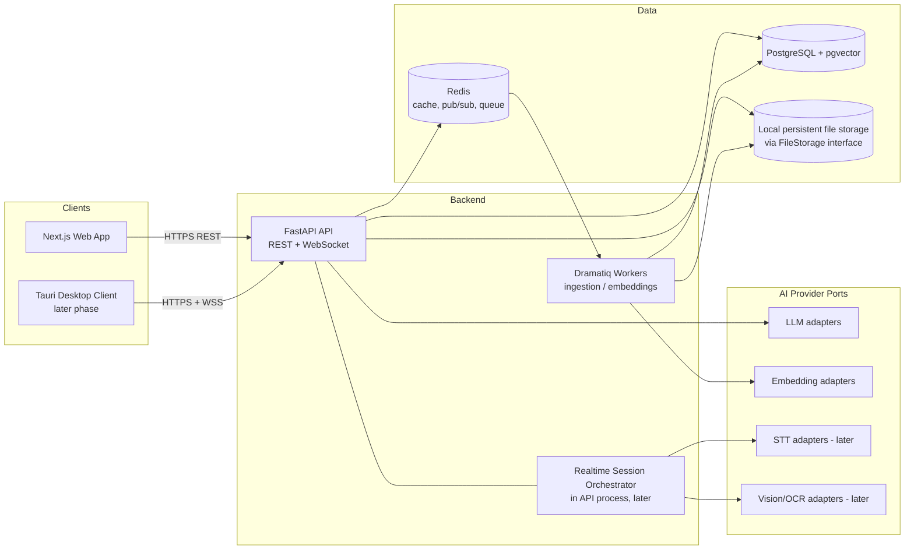
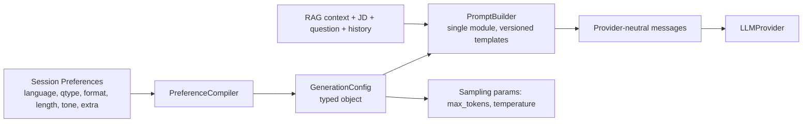
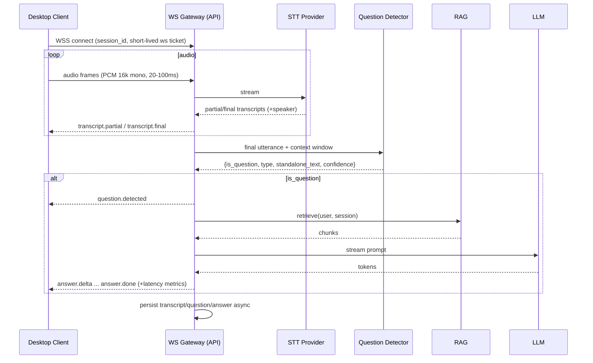

# Architecture

Status: Phase 0 design. Binding status of each choice is tracked in `DECISIONS.md` (approved: web, backend, PostgreSQL, pgvector, Dramatiq/Redis, Tauri 2 (PoC-gated), WebSockets, AI port abstraction, isolation model).

## 1. High-Level Architecture



## 2. Component Responsibilities
| Component | Responsibility |
|---|---|
| Web app | Auth UI, dashboard, resume/doc management, 2-step session wizard, history views. Talks only to API. |
| Desktop client | Floating overlay, typed Q, user-initiated screenshot, audio capture (native), WS streaming, transcript view. Holds tokens in OS keychain. |
| API (FastAPI) | AuthN/Z, validation, CRUD, streamed uploads/downloads through `FileStorage`, enqueue jobs, session config, RAG query, LLM streaming, WebSocket gateway. |
| Workers | Text extraction, chunking, embedding, indexing, cleanup, retry/failure handling. No user-facing HTTP. |
| PostgreSQL | System of record; pgvector for embeddings; row-level security as defense-in-depth. |
| Redis | Rate-limit counters, caches, queue broker, WS fan-out pub/sub, short-lived session state. Not a system of record. |
| File storage (`FileStorage` → local persistent disk) | Original uploaded files and screenshots; private, outside any web-served path; PostgreSQL holds metadata and ownership only (D-26). |
| AI provider layer | Provider-neutral ports + adapters, routing, fallback, usage/latency metrics. |

Monorepo layout: see `CLAUDE.md`. API and worker share one Python codebase (`services/api`) with separate entrypoints.

## 3. Backend Layering (modular monolith)
`routers → services → repositories → DB`; `ai/` ports and `rag/` modules called by services. Routers never touch DB or providers directly. Repositories require a `user_id` argument for user-owned tables (isolation by construction).

Modules: `auth`, `users`, `resumes`, `documents`, `ingestion`, `rag`, `sessions`, `preferences` (prompt/config compiler), `ai` (providers), `jobs_import` (job URL), `realtime` (later), `transcripts` (later), `audit`.

## 4. Data Flow — Upload & Ingestion
```mermaid
sequenceDiagram
  participant U as User (Web)
  participant A as API
  participant O as FileStorage (local persistent disk)
  participant Q as Redis/Dramatiq
  participant W as Worker
  participant P as Postgres/pgvector
  participant E as Embedding Provider
  U->>A: POST /resumes (multipart)
  A->>A: validate size, ext, MIME, magic bytes
  A->>O: store original (key: user_id/uuid)
  A->>P: insert resume (status=uploaded) + ingestion_job(queued)
  A->>Q: enqueue(job_id)
  A-->>U: 202 {id, status}
  Q->>W: deliver job
  W->>O: fetch file
  W->>W: malware scan (if enabled), extract text, normalize
  W->>W: chunk (structure-aware)
  W->>E: embed batches
  W->>P: upsert chunks+vectors (idempotent by source_id+chunk_index+content_hash)
  W->>P: job=succeeded, resume.status=ready
  Note over W,P: on error: retry w/ exponential backoff+jitter; after N attempts job=failed with reason
```
Reliability: DB `ingestion_jobs` row is source of truth. A periodic reaper re-enqueues jobs stuck in `queued/running` past a timeout (handles lost broker messages / crashed workers). Steps are idempotent (delete-then-insert chunks per `source_id` inside a transaction or upsert by hash).

Chunking: structure-aware (headings/sections for resumes: experience, skills, projects), ~300–500 tokens with ~50 token overlap for generic docs; each chunk keeps `section`, `page`, `chunk_index`. Scanned PDFs: OCR fallback (open question OQ-6).

## 5. RAG Architecture
- **Index (as implemented in Phase 5, D-30/D-31/D-32):** `chunks` (text + offsets, one row per chunk) and `chunk_embeddings` (`vector(1024)` per chunk **and embedding model**), produced by the `embed` stage of the ingestion jobs after text extraction. Embedding runs locally (`intfloat/multilingual-e5-large` via fastembed) behind the `EmbeddingProvider` interface. Retrieval is the internal `search_chunks` service (no public endpoint): user ownership and the query's model id are enforced in the SQL, with an exact (non-ANN) scan over the user's own chunks. Original plan, kept for context: `chunks(id, user_id, source_type, source_id, chunk_index, text, embedding, embedding_model, metadata)`.
- **Retrieval query (always):** `WHERE user_id = :uid AND source_id = ANY(:selected_ids)` then vector similarity (cosine, HNSW index) top-k (default 8) + optional lightweight rerank/MMR. Selected IDs come from the **session record on the server**, never from client input at query time.
- **Context assembly:** job description + company + session preferences are passed directly (not retrieved). The resume gets a guaranteed minimum quota of chunks (e.g., 3 of k) so profile facts are always present for "tell me about yourself".
- **Query formation:** the detected/typed question (+ short conversation window for follow-ups) → optionally rewritten into a standalone query by a small fast model.
- **Isolation (defense in depth):** (1) repository requires `user_id`; (2) SQL filter by both `user_id` and selected source IDs; (3) Postgres RLS with `SET LOCAL app.user_id`; (4) automated cross-user tests. Because pgvector lives in the same DB as ownership data, isolation is a single predicate rather than a cross-system sync problem.
- **Embedding model versioning:** `embedding_model` and dimension stored per chunk; model change = re-embed job + new column/table version. Multilingual model required (Hindi/Telugu); selection is OQ-3.
- **Hybrid search (optional later):** Postgres FTS (`tsvector`) + vector fusion for keyword-heavy technical terms.
- **Prompt-injection:** retrieved text and job pages are wrapped as clearly delimited, untrusted data; system prompt instructs the model to ignore instructions inside them.

### Vector DB Evaluation
| Criterion | pgvector | Qdrant |
|---|---|---|
| Ops simplicity | One fewer service; same backups | Extra service, backups, monitoring |
| User isolation | Same-DB join + RLS | Payload filter; must keep in sync with PG |
| Consistency/delete | Transactional with metadata | Eventual cross-system; cleanup jobs |
| Scale fit | Fine for per-user corpora (thousands–low millions of chunks) | Better at very large/high-QPS |
| Filtered search | HNSW + filter can lose recall with very selective filters; mitigated since per-user sets are small (exact scan viable) | Strong filtered HNSW |
| **Verdict** | **Approved for MVP** | Upgrade path behind `VectorStore` port |

Per-session candidate sets are tiny (one resume + a few docs), so even exact search is fast; this strongly favors pgvector.

## 6. AI Provider Abstraction
Separate **ports** (interfaces) so capabilities can be mixed across providers:
```
LLMProvider.stream_chat(messages, GenerationConfig) -> AsyncIterator[Token|ToolCall|Usage]
LLMProvider.complete(...)                           -> Completion
EmbeddingProvider.embed(texts, model)               -> list[Vector]
STTProvider.stream(audio_chunks, lang)              -> AsyncIterator[Transcript events]   (later)
VisionProvider.extract_text/describe(image, ...)    -> ImageResult                       (later)
```
- **Adapters:** Gemini, OpenAI, Anthropic, Groq, Sarvam (evaluated; Sarvam particularly for Indic STT/LLM — verify current capabilities during PoC).
- **Registry/config:** `providers.yaml` (or DB table later) lists provider, models, capabilities (streaming, vision, languages, context window), enabled flag, tier. Credentials from env/secret manager only.
- **Policy:** server decides which provider/model a user may choose (allowlist). Request is validated against it.
- **Router:** order = user selection → fallback chain per capability. Fallback triggers: timeout to first token (e.g., 4s), 5xx, rate limit. Circuit breaker per provider.
- **Normalization:** unified message format, unified error taxonomy (`RateLimited`, `Timeout`, `ContentFiltered`, `AuthError`, `Unavailable`), unified usage record (tokens, latency, provider, model).
- **Contract tests:** the same suite runs against every adapter (using recorded fixtures; optional live smoke).
- **Phase 6 status (D-33):** implemented in `app/ai/`: port, registry, router, breaker, taxonomy, usage records, fake provider. Real adapters (only in `app/ai/adapters/`) are deferred until OQ-4 is resolved. Config is env-based (`LLM_*`), not `providers.yaml`. Streams fall back only before the first token.
- Model IDs are configuration, not code; verify current model names at integration time.

## 7. Preferences → Structured Generation (no scattered prompt logic)

- **Config types (D-34):** the compiled preferences are an `AnswerConfig` (`language`, `question_type`, `answer_format`, `answer_length` with a word band, `answer_tone`, `extra_instructions` (cleaned, length-capped), optional `provider`/`model`); sampling parameters (`temperature`, `max_output_tokens`) stay in the Phase 6 `GenerationConfig`. `CompiledPreferences` carries both. (Earlier drafts called the whole object `GenerationConfig`.)
- **Phase 7A status:** implemented in `app/preferences/` (enums, compiler, sanitizer, `PromptBuilder`, templates under `templates/v1/`). Untrusted text goes only into delimited `<<<BEGIN/END UNTRUSTED:label>>>` blocks of the user message; the system message is trusted template text only.
- **Phase 7B status (D-35):** sessions backend in `app/sessions/` (repository with user-scoped queries only, material validation, service, router). It uses the 7A compiler to store the compiled snapshot and `prompt_version`; it never builds prompts, retrieves chunks or calls an LLM.
- **Phase 8A status (D-38):** `app/qa/` implements context assembly (top-k 8, resume quota 3, character budget, last-3 history, raw question as query), the `QuestionAnswerer` orchestration with persistence (`detected_questions`, `generated_answers`) and latency metrics, using the existing `search_chunks`, `PreferenceCompiler`, `PromptBuilder` and `LLMRouter`; the router now also yields a `StreamMeta` (provider, model, `fallback_used`) event. No endpoints/SSE in 8A (added in 8B, below).
- **Phase 8B status (D-39):** `app/qa/router.py` (SSE `POST` + two history `GET`s), `sse.py` (framing and `SseResponse`, whose cleanup always closes the answer generator and releases the user's slot), `limits.py` (per-user rate and concurrency, in-process), `history.py` (owner-scoped reads with lazy expiry of stale `streaming` answers). The generator opens its own short DB sessions; no session is held for the stream's lifetime.
- `PreferenceCompiler` is the only place mapping enums → config (e.g., Length=Short → ~60–90 words / `max_output_tokens`≈150; Balanced ≈120–180 words; Long ≈250+). Numbers tunable in config.
- `PromptBuilder` is the only place that builds prompts: a base system template + per-`question_type` strategy fragment (e.g., Behavioral → STAR structure; System design → requirements/components/trade-offs; Coding → approach, complexity, code) + per-format and per-tone fragments. Templates are versioned files; `prompt_version` is stored with each generated answer.
- When question type is not set by the user to a fixed value, the question classifier (§9) may infer it per question; the user preference acts as default/override (open question OQ-9).
- Snapshot tests assert compiled prompts for each combination class.

## 8. Real-Time Architecture (gateway built in Phase 9; audio/transcription later)
WebSocket chosen over SSE/gRPC: bidirectional (audio up, events down), supported by Tauri webview and Rust clients, simple to deploy behind standard proxies. Audio is binary frames; control/events are JSON.


- Horizontal scale: WS connections are sticky per node; Redis pub/sub only needed if multiple nodes must publish to one connection (e.g., worker → client). Session state is reconstructable from DB.
- Backpressure: bounded audio queue; drop/degrade policy; heartbeat/ping; reconnect with `resume_from_seq` against a bounded in-memory event buffer (D-41; the earlier `last_event_id`/resume-token wording is superseded).
- Auth: short-lived single-use WS ticket obtained via REST (`POST /auth/ws-ticket`), stored hashed in Redis and bound to user and session, so the access token never appears in a URL (D-41). Module: `app/realtime/` (schemas, tickets, limits, gateway); the contract is `docs/API.md` section 8.
- Cancellation: an explicit `answer.cancel` or the end of the resume grace period cancels the in-flight generation; a new question while one is generating is refused, never an implicit cancel (D-41, supersedes the earlier "new question cancels" wording).

## 9. Question Detection Pipeline (later)
`Audio → STT → utterance segmentation (VAD + punctuation/silence endpointing) → classify → retrieve → generate`

Two-stage detector to keep latency low and avoid over-triggering:
1. **Cheap heuristics/rules (≈ms):** interrogative forms, wh-words, imperative prompts ("Tell me about…", "Walk me through…", "Describe…", "Explain…"), multilingual lexicons (en/hi/te), speaker role (interviewer vs candidate if diarization available), length, filler/backchannel filter ("okay", "right", "I see").
2. **Small-LLM classifier (fast model, structured JSON output):** input = last 3–6 utterances + JD title; output `{is_question, kind: explicit|implicit|followup|statement, question_type, standalone_question, confidence}`.
- **Explicit:** interrogatives → high prior, still classified (rhetorical/tag questions like "right?" excluded).
- **Implicit:** imperatives/statements functioning as questions ("I'd like to hear about a time you led a team").
- **Follow-up:** short fragments ("and why that approach?") resolved against previous Q&A into a `standalone_question`.
- **No-answer statements:** small talk, instructions, candidate's own speech, interviewer commentary, acknowledgements.
- **Triggering policy:** auto-answer only above a confidence threshold; between thresholds show a "Possible question — tap to answer" affordance; user can always force-answer or dismiss. Debounce while interviewer is still speaking (wait for endpoint).
- Speaker awareness: use provider diarization or channel separation (system audio = interviewer, mic = candidate) where possible — channel separation is more reliable than diarization (PoC).
- Evaluated on a labeled set: precision/recall of trigger, false-trigger rate (see TESTING_STRATEGY).

## 10. Screenshot Pipeline (later)
`Client captures on explicit user action → POST /sessions/{id}/screenshots → validate (type PNG/JPEG/WebP, size ≤ 5 MB, dimensions, magic bytes; strip EXIF) → store (retention-limited) → VisionProvider (multimodal LLM direct, or OCR then text LLM) → extract question/code → retrieve → generate (streamed over WS)`.
Modes selectable by config: (a) multimodal LLM end-to-end, (b) OCR → text. Provider-independent via `VisionProvider` port. Screenshots default to short retention (e.g., 24h–7d, configurable) and are deletable.

## 11. Desktop Client Architecture (later)
- **Tauri 2 + React + TS (Approved, subject to platform PoC).** Small footprint, Rust backend for native audio/screenshot/keychain, webview UI. Alternative: Electron (mature, larger, more consistent capture APIs via Chromium `desktopCapturer`, but heavy). PoC required for audio capture (see RISKS).
- Modules: `ui` (React overlay), `core` (Rust: window control, global hotkeys, always-on-top, click-through toggle, opacity), `audio` (capture adapters per OS behind a trait: mic; system loopback — WASAPI on Windows, ScreenCaptureKit/CoreAudio on macOS, PulseAudio/PipeWire monitor on Linux), `capture` (screenshot on user action), `net` (REST+WS client, reconnect), `store` (tokens in OS keychain; no plaintext secrets).
- User control: visible capture indicator (mic/system-audio/screenshot), one-click pause/stop, no background capture when no active session, no hidden-capture features.
- Auth: system-browser login with device/PKCE flow → tokens in keychain; or in-app login (decision pending OQ-8).
- Auto-update: signed updates (later).

## 12. Latency Budget & Performance Targets
Targets are **goals under normal conditions, provider-dependent, measured at p50/p95, not guarantees**. Final numbers set after PoC.

| Path | Stage | p50 target | p95 target |
|---|---|---|---|
| Typed question | request → retrieval done | ≤ 150 ms | ≤ 400 ms |
| | LLM first token (fast tier model) | ≤ 800 ms | ≤ 2 s |
| | Total request → first token | ≤ 1.2 s | ≤ 2.5 s |
| RAG retrieval | embed query (cached/short) | ≤ 100 ms | ≤ 300 ms |
| | vector search (tiny per-session set) | ≤ 30 ms | ≤ 100 ms |
| Audio transcription | speech end → final transcript | ≤ 500 ms | ≤ 1.5 s |
| | partial transcript lag | ≤ 300 ms | ≤ 800 ms |
| Question detection | heuristics | ≤ 10 ms | ≤ 30 ms |
| | LLM classifier | ≤ 400 ms | ≤ 1 s |
| Screenshot | upload + validation | ≤ 500 ms | ≤ 1.5 s |
| | image understanding/OCR | ≤ 2 s | ≤ 5 s |
| | request → first answer token | ≤ 3.5 s | ≤ 7 s |
| Ingestion (async) | 10-page resume → Ready | ≤ 30 s | ≤ 2 min |

Latency levers: stream everything; pre-embed/pre-warm session context at session start (cache JD + resume summary); Redis cache for query embeddings and session config; speculative retrieval on partial transcript; small model for classification; provider fallback on first-token timeout; keep-alive connections to providers; trim context to token budget. Per-stage timing recorded (`latency_ms` fields) for tuning.

## 13. Deployment Architecture
| Env | Shape |
|---|---|
| **Dev** | `docker compose` (introduced Phase 1): postgres(+pgvector), redis (api/worker/web run on the host); uploads go to a git-ignored local directory (`app-data/`) via `FileStorage`. Hot reload. Fake/stub AI providers by default; real providers via local env. |
| **Staging** | Single small VM or managed container service with managed/self-hosted PG, Redis, and a persistent volume for uploads. Production-like config, real provider keys with low quotas, seeded test data only. |
| **Production (initial, cost-conscious)** | 1 VM (or small container platform): reverse proxy (Caddy/Nginx, TLS) → web + api (2 replicas if possible) + worker; managed Postgres preferred (backups/PITR); managed Redis or self-hosted with persistence; a persistent volume/disk mounted at the storage root for uploads (API and worker must share it). Later: separate worker nodes, read replica, autoscaled API, Qdrant if needed. |

Required services: web, API, worker, Postgres+pgvector, Redis, persistent file-storage volume, reverse proxy/TLS, log/metrics stack, secret store, (optional) ClamAV for scanning.
Cloud provider is undecided (OQ-1); design is container-based and uses only portable interfaces (a POSIX filesystem behind `FileStorage`, Postgres, Redis). No cost estimates are provided here; compute them from current provider pricing when the provider is chosen.

**Config & secrets:** 12-factor env vars. Dev: `.env` (gitignored) with `.env.example` listing names only. Staging/prod: secret manager (cloud-native, Doppler/Vault, or SOPS-encrypted files as minimal option). Key variables (names only): `DATABASE_URL`, `REDIS_URL`, `FILE_STORAGE_ROOT` (final names set in Phase 3), `JWT_SIGNING_KEY` (+ rotation `KID`), `ENCRYPTION_KEY`(s), `GEMINI_API_KEY`, `OPENAI_API_KEY`, `ANTHROPIC_API_KEY`, `GROQ_API_KEY`, `SARVAM_API_KEY`, `CORS_ORIGINS`, `MAX_UPLOAD_MB`, `SENTRY_DSN`. Provider keys are server-side only — never shipped to clients.

**File storage (D-26, replaces object storage):** Uploaded files live on persistent local server storage behind a `FileStorage` interface; PostgreSQL stores metadata and ownership only.
- *Layout:* `<storage-root>/uploads/<user_id>/<kind>/<uuid>` (kind = resumes | documents | screenshots). Names on disk are server-generated; original filenames are DB metadata only.
- *Persistence:* application containers/code are disposable; uploaded files are not. In containerized deployment the storage root (e.g. `/app-data`) MUST be a persistent volume or equivalent server storage, mounted into both the API and the worker. Losing the mount means losing every upload.
- *Security:* per-user isolation; no client-supplied paths or filenames used as paths; keys server-generated and resolved paths verified to stay inside the root; validate before store (temp file + atomic move); ownership enforced on every read/delete; never exposed via a public static directory, only streamed by an authenticated endpoint; restrictive permissions for the service account; disk-level encryption at rest.
- *Operations:* disk-usage monitoring, retention sweeps (e.g. screenshots), orphan reconciliation, joint backup/restore with Postgres.

**Backups:** Postgres daily full + WAL/PITR where available; retention 14–30 days (TBD); encrypted; restore drill each quarter; the file-storage volume backed up/snapshotted together with Postgres so restores are consistent (DB rows reference files); Redis not backed up as source of truth (queue state reconstructable from `ingestion_jobs`).

**Logging/monitoring:** structured JSON logs with `request_id`, `user_id` (hash/ID only), no content payloads; metrics (Prometheus/OpenTelemetry): request latency, error rates, queue depth/age, job failures, provider latency/error/fallback counts, WS connections, first-token latency; error tracking (Sentry or equivalent); uptime checks; alerts on queue stuck, 5xx rate, provider failure rate, disk/DB saturation.

## 14. Security Architecture (summary; details in DECISIONS D-12…D-15)
- **Passwords:** Argon2id (OWASP-recommended parameters, tuned to ~100–250 ms), unique salt, optional pepper from secret store; no truncation; breach-list check optional later.
- **Tokens:** access JWT (≈15 min, asymmetric or HMAC with key rotation via `kid`) + opaque refresh token (≈7–30 d), stored hashed in DB, rotated on use with reuse detection (family revocation). Web: refresh in `HttpOnly; Secure; SameSite=Lax` cookie, access token in memory; CSRF protection on cookie-authenticated endpoints. Desktop: tokens in OS keychain. WS: single-use ticket.
- **Authorization:** every resource is owned by `user_id`; ownership checked in repository layer; cross-user → 404 (not 403) to avoid existence leaks; RLS as backstop. Roles minimal initially (`user`; `admin` later).
- **Upload validation:** extension allowlist + magic-byte sniff + MIME match; size caps; reject encrypted/macro-enabled/archive types; page/size limits; filename never used as path; PDF/DOCX parsed in a sandboxed worker with timeouts and memory limits (decompression bombs, malformed files).
- **Malware scanning:** ClamAV (clamd) in worker before extraction when enabled; files quarantined until scanned (`status=scanning`). Optional in dev; recommended in prod.
- **Rate limiting:** Redis token-bucket per IP and per user; stricter on `/auth/*`, uploads, job-URL fetch, LLM endpoints; account lockout/backoff on repeated login failures.
- **Job URL fetch (SSRF):** http/https only, resolve DNS and block private/loopback/link-local/metadata ranges, re-validate after redirects, size/time caps, no cookies/credentials, respect robots.txt/ToS where applicable, descriptive User-Agent; extraction best-effort with manual fallback.
  - **Implemented in Phase 7C (D-36)** in `app/jobs_import/`: all of the above except robots.txt (not enforced in this version, R-29), plus ports 80/443 only, all-records-must-be-public resolution, connection pinned to the validated IP (anti DNS-rebinding), per-user rate limit and concurrency cap, one shared message for every network-level failure, and no URL/content in logs.
- **Secrets:** never in code/images/logs; secret manager; rotation procedure documented; least-privilege IAM for storage.
- **Transit/rest:** TLS 1.2+ everywhere (HSTS), WSS only; DB and storage encryption at rest; optional application-level encryption of transcript/document text columns (open question OQ-10).
- **Sensitive data handling:** transcripts/documents/screenshots are personal data: minimized logging, configurable retention, user-initiated delete (hard delete incl. vectors/files), data sent to third-party AI providers only as needed (provider data-use/retention terms must be reviewed; zero-retention settings preferred) — see RISKS.
- **Audit logging:** append-only `audit_events` (login, logout, failed login, password change, upload, delete, session create/delete, export, admin actions) with actor, IP (truncated/hashed per policy), timestamp; no content.
- **Other:** security headers/CSP, dependency scanning, SAST in CI, prompt-injection mitigations, output rendering escaped (markdown sanitized) in clients.

## 15. Technology Choices & Tradeoffs
| Choice | Why | Tradeoffs / alternatives |
|---|---|---|
| Next.js + React + TS | Mature, good DX, shares React/TS with desktop UI, typed API client codegen | Heavier than SPA; SSR benefits are small for an authenticated app — acceptable; alt: Vite SPA |
| FastAPI (Python) | Best AI/doc-processing ecosystem; async + native WebSockets & streaming; Pydantic typing/OpenAPI | GIL/CPU-bound work must go to workers; alt: Node/NestJS (single language) |
| PostgreSQL | Relational integrity, RLS, pgvector, FTS | Single DB is a scaling point; fine at internal scale |
| Redis | Rate limit, cache, broker, pub/sub in one | Another service; persistence config needed for queue durability (AOF) |
| `FileStorage` + local persistent disk | No extra service or cloud knowledge needed for an internal deployment; interface keeps object storage as a future option (D-26) | Single-host coupling (API+worker share the volume); backups/capacity are our job; scale-out needs a new implementation |
| Dramatiq (+ `ingestion_jobs` table) | Simple, reliable retries, Redis broker, sync-friendly for CPU/IO doc work | Alt: Celery (heavier, more features), Arq (async, less active), Procrastinate/pg-queue (no Redis dependency for jobs). Recommendation reviewed in D-05 |
| pgvector | See §5 | Qdrant if scale/filters outgrow it |
| WebSockets | See §8 | SSE for one-way answer streaming on web is viable; WS unifies with audio |
| Tauri 2 | Small, secure, Rust native access | Smaller ecosystem, per-OS audio capture work, webview differences; Electron fallback |

## 16. Scalability Considerations
- API stateless → scale replicas; WS sticky per connection, session state in DB/Redis.
- Workers scale independently by queue depth; separate queues for ingestion vs. maintenance.
- DB: connection pooling (PgBouncer later), indexes per DATABASE.md, partition `transcript_segments` by time if needed, read replica for history.
- Vector: swap to Qdrant behind `VectorStore` when chunk count/QPS demands; dual-write migration path.
- Provider rate limits are the likeliest bottleneck: per-provider concurrency limits, queueing, fallback.
- Storage grows with files/screenshots: retention sweeps, orphan cleanup, disk-usage alerts. Local storage ties API and worker to one host (or shared mount); scaling beyond that means a new `FileStorage` implementation (e.g. object storage) plus a one-time data migration (D-26).
