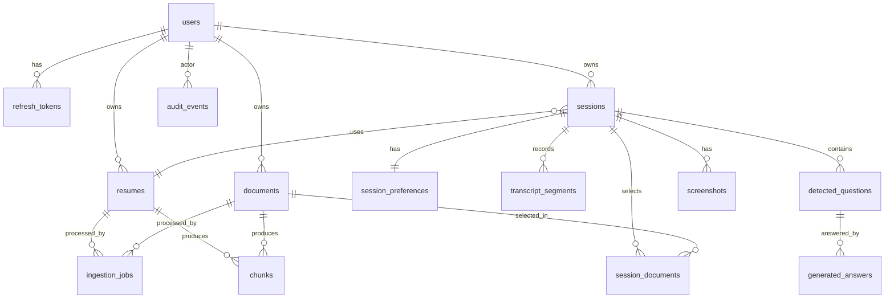

# Database Design (initial relational model)

PostgreSQL 16+ with `pgvector`; the implemented schema is managed by Alembic migrations under `services/api/alembic/versions/`. Conventions: UUID v7 primary keys (time-ordered) or `gen_random_uuid()`; `created_at/updated_at timestamptz` on all tables; enums as Postgres enums or `text` + CHECK (prefer text+CHECK for easier evolution); soft delete only where noted.

## 1. Entity Relationship

## 2. Tables

### users
*Phase 2 implemented subset: `id`, `email` (citext, unique), `password_hash`, `status`, `last_login_at`, `created_at`, `updated_at`. `display_name`, `email_verified_at`, and lockout columns are not created yet (deferred; add by migration when needed). `refresh_tokens` is implemented without `device_label`/`ip_hash`; `client_type` is constrained to `web`/`desktop`.*

| Column | Type | Notes |
|---|---|---|
| id | uuid PK | |
| email | citext UNIQUE NOT NULL | case-insensitive |
| password_hash | text NOT NULL | Argon2id encoded string |
| display_name | text NULL | |
| status | text | `active`,`disabled` |
| email_verified_at | timestamptz NULL | reserved for later email verification (D-24); unused initially |
| failed_login_count / locked_until | int / timestamptz | lockout |
| last_login_at, created_at, updated_at, deleted_at | timestamptz | |

### refresh_tokens
`id uuid PK, user_id FK→users ON DELETE CASCADE, family_id uuid, token_hash text UNIQUE, client_type ('web','desktop'), device_label text, expires_at, revoked_at, replaced_by uuid NULL, created_at, last_used_at, ip_hash`. Index: `(user_id)`, `(family_id)`, `(expires_at)`.

### resumes
*Phase 3 implemented subset (resumes and documents alike): `id`, `user_id` (FK, cascade), `original_filename` (sanitised display name), `content_type` (server-detected), `size_bytes` (> 0), `sha256`, `storage_key` (unique), `created_at`, with index `(user_id, created_at DESC)`. `title`, `status`, `status_reason`, `language`, `page_count`, `text_char_count`, `updated_at` and `deleted_at` arrive with ingestion in Phase 4. Deleting a user cascades to rows but not to stored files (account deletion is not built).*

`id, user_id FK NOT NULL, title text, original_filename text, mime_type text, size_bytes bigint, sha256 char(64), storage_key text, status ('uploaded','scanning','processing','ready','failed','deleting'), status_reason text NULL, language text NULL, page_count int NULL, text_char_count int NULL, created_at, updated_at, deleted_at`.
Indexes: `(user_id, created_at DESC)`, `(user_id, sha256)` (dedupe hint, not unique). Extracted full text is **not** duplicated here (chunks hold it); optional `extracted_text_key` in file storage if needed.
`storage_key` is a server-generated key relative to the storage root (e.g. `uploads/<user_id>/resumes/<uuid>`), resolved only through `FileStorage` (D-26). It is never client-supplied; `original_filename` is display metadata and is never used as a path. The same applies to `documents` and `screenshots`.

### documents
Same shape as `resumes` plus `doc_type text NULL` (e.g., notes, project, cert, other). Kept as a separate table (clear ownership, different limits/UI) rather than a polymorphic table; shared Python base class. *(Alternative: single `files` table with `kind`; see DECISIONS D-17.)*

### ingestion_jobs
*Phase 4 implemented subset (owner-approved status names): `id`, `user_id` (FK cascade), `source_type` (`resume`/`document`), `source_id` (polymorphic, no FK; cleaned up explicitly in the same transaction as the file delete), `status` (`pending`, `processing`, `completed`, `failed`), `attempt`, `error_code`, `error_message` (fixed safe strings), `locked_at`, `started_at`, `finished_at`, `created_at`, `updated_at`. **One row per source file** (`UNIQUE (source_type, source_id)`); a retry resets that row instead of adding history. Indexes: `(user_id)`, `(status, updated_at)` for the recovery sweep. Not yet implemented: `stage`, `max_attempts` (a setting instead), `next_attempt_at`, `locked_by`, `embedding_model`, `cancelled`. The table below is the longer-term design.*

| Column | Type | Notes |
|---|---|---|
| id | uuid PK | |
| user_id | uuid FK | denormalized for isolation/queries |
| source_type | text | `resume` / `document` |
| source_id | uuid | polymorphic FK (enforced via CHECK + trigger or app layer) |
| status | text | `queued`,`running`,`succeeded`,`failed`,`cancelled` |
| stage | text | `validate`,`scan`,`extract`,`chunk`,`embed`,`index` |
| attempt | int default 0 | |
| max_attempts | int default 5 | |
| next_attempt_at | timestamptz | backoff scheduling |
| locked_at / locked_by | timestamptz / text | worker lease for reaper |
| error_code / error_message | text | sanitized, no document content |
| embedding_model | text | |
| started_at, finished_at, created_at, updated_at | | |
Indexes: `(status, next_attempt_at)`, `(user_id, created_at DESC)`, `(source_type, source_id)`. Unique partial index: one active job per source: `UNIQUE (source_type, source_id) WHERE status IN ('queued','running')`.

### extracted_texts (Phase 4)
`id`, `user_id` (FK cascade), `source_type`, `source_id` (`UNIQUE (source_type, source_id)`, so re-processing upserts and never duplicates), `text` (**sensitive**, normalised), `char_count`, `extractor` (`pymupdf` | `python-docx` | `text`), `created_at`, `updated_at`. This is the input for the Phase 5 chunker, which will create `chunks` from it. Only read through user-scoped accessors; not exposed by any API.

### chunks / chunk_embeddings (Phase 5, implemented)
*Implemented design (D-31): **`chunks`** = `id`, `user_id`, `source_type`, `source_id`, `chunk_index`, `text` (sensitive), `char_start`, `char_end`, `content_hash`, `created_at`; unique `(source_type, source_id, chunk_index)`; index `(user_id, source_type, source_id)`. **`chunk_embeddings`** = `chunk_id` (FK, cascade), `embedding_model`, `user_id` (FK, cascade), `embedding vector(1024)`, `created_at`; PK `(chunk_id, embedding_model)`; index `(user_id, embedding_model)`; no ANN index yet. `ingestion_jobs` gained `stage` (`extract`/`embed`) with `UNIQUE (source_type, source_id, stage)`; `extracted_texts` gained `text_sha256`. Deleting a file removes jobs, text and chunks in one transaction (embeddings cascade from chunks). The design below is the earlier single-table plan.*

### chunks (earlier plan: vector store, pgvector)
| Column | Type | Notes |
|---|---|---|
| id | uuid PK | |
| user_id | uuid NOT NULL FK | isolation key |
| source_type | text | resume/document |
| source_id | uuid NOT NULL | |
| chunk_index | int | |
| section | text NULL | e.g., "Experience" |
| page | int NULL | |
| text | text | **sensitive** |
| token_count | int | |
| content_hash | char(64) | idempotent upsert |
| embedding | vector(N) | N set by chosen embedding model (OQ-3) |
| embedding_model | text | enables re-embedding |
| tsv | tsvector (generated) | optional hybrid search |
| created_at | timestamptz | |
Constraints: `UNIQUE (source_type, source_id, chunk_index)`.
Indexes: `(user_id, source_id)`, HNSW on `embedding vector_cosine_ops` (created when data volume warrants; exact scan is acceptable for small filtered sets), GIN on `tsv` (optional).
If different embedding dimensions are needed, use one table per model/dimension (`chunks_v1`, …) — decision D-16.

### sessions (Phase 7B, implemented; migration 0006)
`id uuid PK, user_id FK→users CASCADE, type text default 'interview' CHECK ('interview'), title text NULL, company_name text NOT NULL CHECK (1..200 chars), job_url text NULL (stored as typed, never fetched in 7B), job_description text NOT NULL CHECK (non-empty; the 20,000-character cap is a setting, not a DB constraint), resume_id FK→resumes NULL ON DELETE SET NULL, resume_snapshot jsonb NOT NULL ({id, filename} at selection time), materials_snapshot jsonb NOT NULL default [] ([{id, filename}] of the selected documents), status text default 'ready' CHECK (draft, ready, active, ended, archived), created_at, updated_at`.
Indexes: `(user_id, created_at DESC, id DESC)` (list + keyset pagination), `(user_id, status)`, `(resume_id)` (FK maintenance on resume delete).
**Not in 7B (added by the phase that needs them):** `job_import_status` (7C), `started_at`/`ended_at` (start/end endpoints, later phase), `deleted_at` (sessions are hard-deleted, D-35). 7B only creates `ready` sessions because materials must be ready; the other statuses are reserved documented states.

### session_documents (Phase 7B)
`PRIMARY KEY (session_id, document_id)`, `session_id`→sessions CASCADE, `document_id`→documents CASCADE, `user_id`→users CASCADE (denormalised owner, set only from the authenticated user), index `(document_id)`. Deleting a document removes only the link; the label survives in `sessions.materials_snapshot` and the API reports it as `available: false`. **Owner decision (D-35): no composite `(id, user_id)` foreign keys on `resumes`/`documents`;** same-owner integrity is enforced by the service (every material is looked up by `user_id`) and covered by isolation tests. Revisit only if a concrete integrity gap appears (R-26).

### session_preferences (Phase 7B)
`session_id PK/FK→sessions CASCADE, language, provider NULL, model NULL, stt_provider NULL, stt_model NULL (**migration 0010, D-57:** voice-listening selection; NULL = none chosen yet, transcription refused; CHECK `stt_model IS NULL OR stt_provider IS NOT NULL`; provider/model ids only, never credentials), question_type, answer_format, answer_length, answer_tone, extra_instructions text default '', generation_config jsonb NOT NULL (CompiledPreferences.to_dict snapshot), prompt_version text NOT NULL, created_at, updated_at`. CHECK constraints mirror the Phase 7A enums exactly (a test compares them, so the lists cannot drift); `model IS NULL OR provider IS NOT NULL`. NULL provider/model = use the server default chain when answering (Phase 8). No `user_id` column: rows are only reached through a user-scoped session.

### transcript_segments (later phase)
`id, session_id FK, user_id FK, seq int, speaker ('interviewer','candidate','unknown'), speaker_label text, language text, text text (sensitive), is_final bool, started_at_ms int, ended_at_ms int, confidence real, stt_provider text, created_at`.
Indexes: `(session_id, seq)`, `(user_id, created_at)`. Only final segments persisted (partials are ephemeral).

### detected_questions (Phase 8A, implemented as typed-only; migration 0007)
**Implemented columns:** `id, session_id FK→sessions CASCADE, user_id FK→users CASCADE, source ('audio','typed','screenshot') default 'typed', raw_text NOT NULL, kind ('explicit','implicit','followup') default 'explicit', question_type NULL (the type actually used: override or session's), status ('detected','answered','dismissed','ignored') default 'detected', detected_at`; index `(session_id, detected_at)`. Not yet created: `segment_ids`, `screenshot_id`, `standalone_text`, `confidence`, `detection_latency_ms`. Original design, kept for later phases:
`id, session_id, user_id, source ('audio','typed','screenshot'), segment_ids uuid[] NULL, screenshot_id NULL, raw_text, standalone_text, kind ('explicit','implicit','followup'), question_type text NULL, confidence real, detected_at, status ('detected','answered','dismissed','ignored'), detection_latency_ms int`.
Index: `(session_id, detected_at)`.

### generated_answers (Phase 8A, implemented; migration 0007)
**Implemented:** all columns below except the separate format/length/tone columns (the compiled preferences incl. format, length and tone are in `generation_config`, together with the question-type override and the context settings used); `retrieved_chunk_ids uuid[]` has no foreign key; CHECK constraints for `status` and non-negative metrics; FKs to questions, sessions and users all `ON DELETE CASCADE`. Original design:
`id, question_id FK, session_id, user_id, text (sensitive), format/length/tone snapshot, generation_config jsonb, prompt_version, provider, model, retrieved_chunk_ids uuid[], input_tokens, output_tokens, retrieval_ms, first_token_ms, total_ms, fallback_used bool, status ('streaming','complete','cancelled','error'), error_code, created_at`.
Index: `(question_id)`, `(session_id, created_at)`.
**`grounding_check jsonb NULL` (migration 0009, D-48):** the content-free result of the post-generation *citation-integrity check* of a **completed** answer: `{v, status, shown_count, valid_ids[], unknown_ids[], malformed_count}` with `status` one of `ok`, `invalid_citations`, `no_citations`, `check_error`. It holds evidence-tag numbers and counts only, never answer text, excerpts, source IDs or chunk text. SQL `NULL` means not checked (answer still streaming, cancelled or errored, or created before 0009). A CHECK (`ck_generated_answers_grounding_check_object`) allows only NULL or a JSON object. It is **not** proof that an answer is grounded and is not exposed through any API schema. Additive and nullable; existing rows are not rewritten; downgrade drops the constraint and the column. Row-level security and the runtime role's table grants already cover the table.

### screenshots (later phase; **not created in the Phase 11 MVP, D-51:** screenshots are memory-only, so there is no table, column or migration; `detected_questions.source = 'screenshot'` already exists)
`id, session_id, user_id, storage_key, mime_type, size_bytes, sha256, status, extracted_text (sensitive) NULL, expires_at, created_at`. Index `(expires_at)` for retention sweeps.

### audit_events
`id, user_id NULL, actor_type, event_type, resource_type, resource_id, ip_hash, user_agent_hash, metadata jsonb (no content), created_at`. Append-only (no UPDATE/DELETE grants). Index `(user_id, created_at DESC)`, `(event_type, created_at)`.

## 3. Ownership Relationships
Everything hangs off `users.id`. Every user-owned table carries a **denormalized `user_id`** (resumes, documents, ingestion_jobs, chunks, sessions, session_preferences via session, transcript_segments, detected_questions, generated_answers, screenshots). Child rows must match parent's `user_id` (composite FK `(id, user_id)` references or trigger). Cross-user references (e.g., a session pointing to another user's resume) are prevented by this constraint, not only by application code.

## 4. User Isolation Strategy
1. **Repository layer** requires `user_id`; no method returns a user-owned row without it.
2. **Row-Level Security** is enabled and forced by migration `0008_tenant_rls` on the implemented user-owned tables. Runtime sessions use the non-login, `NOBYPASSRLS` `interview_app_runtime` role and set `app.user_id` transaction-locally. Login and refresh-token lookup use narrowly scoped transaction-local context; ingestion workers bind the database-backed job owner. Session preferences are scoped through their owning session.
3. **Runtime credentials** must be a non-superuser/non-owner login able to `SET LOCAL ROLE interview_app_runtime`; production migration provisioning must grant role membership separately when migration and runtime users differ. Recovery and reindex use the separately configured `MAINTENANCE_DATABASE_URL`; it is never used by request handlers.
4. **Retrieval** always filters by `user_id` and server-resolved selected `source_id`s.
5. **Object keys** are prefixed by `user_id`; access only via API authorization checks.
6. **404 on cross-user access.**
7. **Automated tests**: two-user fixtures for endpoints and retrieval, plus a PostgreSQL test of the runtime role and RLS (see TESTING_STRATEGY).

## 5. Important Indexes (summary)
users(email unique); refresh_tokens(token_hash unique, user_id, family_id); resumes/documents(user_id, created_at desc); ingestion_jobs(status, next_attempt_at) + partial unique active job; chunks(user_id, source_id), HNSW(embedding); sessions(user_id, created_at desc); transcript_segments(session_id, seq); detected_questions(session_id, detected_at); generated_answers(question_id); screenshots(expires_at); audit_events(user_id, created_at desc).

## 6. Data Retention Considerations (proposed defaults; confirm in OQ-11)
| Data | Default | Notes |
|---|---|---|
| Resumes/documents + chunks + files | Until user deletes | Hard delete removes file, chunks, vectors (async, with confirmation record) |
| Sessions + transcripts + Q&A | Until user deletes; optional auto-expire (e.g., 90 days) | Per-session delete cascades |
| Screenshots | 7 days (configurable), or deleted at session end | Shortest because highest sensitivity |
| Raw audio | **Not stored** (stream only) unless explicitly enabled later | |
| Refresh tokens | Until expiry/revocation + 30 days tombstone | |
| Audit events | 12 months (no content) | |
| Account deletion | Hard delete all user data within a defined window (e.g., 30 days), backups age out per backup retention | |
| Backups | Contain deleted data until they expire — document in privacy notice | |
